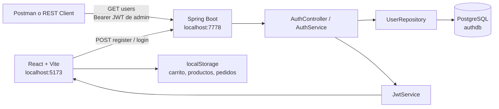

<div align="center">

# AkumaTech
### Tienda gamer · Proyecto Fullstack II

Aplicación de comercio electrónico con frontend en React y una API de autenticación en Spring Boot.


</div>

> **Estado del proyecto:** el frontend permite registrarse e iniciar sesión con el backend. La API también ofrece un listado protegido de usuarios y la desactivación de cuentas para administradores. El catálogo, carrito y pedidos todavía se gestionan localmente en el navegador; no hay endpoints backend para esos datos.

## Contenido

- [Arquitectura](#arquitectura)
- [Funcionalidades](#funcionalidades)
- [Tecnologías y requisitos](#tecnologías-y-requisitos)
- [Inicio rápido](#inicio-rápido)
- [Configuración de PostgreSQL](#configuración-de-postgresql)
- [Variables de entorno](#variables-de-entorno)
- [Ejecución](#ejecución)
- [API](#api)
- [Crear una cuenta administradora](#crear-una-cuenta-administradora)
- [Probar con Postman o REST Client](#probar-con-postman-o-rest-client)
- [Persistencia y migraciones](#persistencia-y-migraciones)
- [Pruebas](#pruebas)
- [Estructura](#estructura)
- [Seguridad y limitaciones](#seguridad-y-limitaciones)

## Arquitectura

El frontend y el backend están en ramas distintas del mismo repositorio:

| Rama | Aplicación |
|---|---|
| `main` | Frontend React/Vite |
| `backend-axel` | API Spring Boot |

En desarrollo local, ambos proyectos se pueden abrir en carpetas separadas:



El frontend envía solamente `email` y `password` al registro. Aunque el formulario visual también solicite nombre, RUT y teléfono, esos campos aún no se envían ni guardan en el backend.

## Funcionalidades

### Frontend

- Catálogo, carrusel de ofertas y tarjetas de productos.
- Carrito persistente, descuentos y modalidades de envío.
- Registro e inicio de sesión conectados a la API.
- Historial y reposición de pedidos almacenados localmente.
- Vistas administrativas locales para estadísticas, productos y usuarios.
- Diseño adaptable y pruebas de componentes, contextos y validaciones.

### Backend

- Registro e inicio de sesión mediante API REST.
- Contraseñas codificadas con BCrypt.
- Emisión y validación de JWT con expiración configurable (24 horas por defecto).
- Persistencia de usuarios en PostgreSQL mediante Spring Data JPA.
- Listado de usuarios sin contraseñas, restringido a administradores.
- Desactivación lógica de usuarios, también restringida a administradores.
- CORS para los orígenes locales de Vite configurados en Spring Security.

## Tecnologías y requisitos

| Área | Tecnología |
|---|---|
| Backend | Java 27, Spring Boot 4.1.2, Gradle Wrapper 9.9.1 |
| API y seguridad | Spring MVC, Spring Security, BCrypt, JJWT 0.12.6 |
| Base de datos | PostgreSQL, Spring Data JPA, Flyway |
| Frontend | React 19, JavaScript, Vite 8 |
| Pruebas frontend | Vitest, Testing Library, jest-axe |

Requisitos para desarrollo local:

- JDK compatible con Java 27.
- PostgreSQL en ejecución (esta guía usa el puerto `5432`).
- Node.js y npm para el frontend.
- Postman o la extensión **REST Client** de VS Code (opcional).

## Inicio rápido

### Backend

Clona la rama del backend y entra en su carpeta:

```powershell
git clone -b backend-axel https://github.com/axbrogi23/AkumaTech_SpringBoot.git AkumaTech-backend
cd AkumaTech-backend
```

Configura PostgreSQL y las variables de entorno indicadas a continuación. Después inicia el servidor:

```powershell
.\gradlew.bat bootRun
```

La API queda disponible en `http://localhost:7778`.

### Frontend

En otra carpeta y otra terminal, clona la rama `main`:

```powershell
git clone -b main https://github.com/axbrogi23/AkumaTech_SpringBoot.git AkumaTech-frontend
cd AkumaTech-frontend
npm ci
npm run dev
```

Vite muestra la dirección de la aplicación, normalmente `http://localhost:5173`. El frontend usa por defecto `http://localhost:7778/api/auth`. Para cambiarla, crea `.env.local` en la raíz del frontend:

```env
VITE_API_URL=http://localhost:7778/api/auth
```

El backend permite CORS para `localhost` y `127.0.0.1` en los puertos `5173` y `4173`.

## Configuración de PostgreSQL

Inicia PostgreSQL y conéctate a la base administrativa `postgres`. En PowerShell:

```powershell
psql -h localhost -p 5432 -U postgres -d postgres
```

En `psql`, crea el usuario y la base de datos. Establece la contraseña de forma interactiva:

```sql
CREATE ROLE authuser WITH LOGIN;
\password authuser
CREATE DATABASE authdb OWNER authuser;
```

Si `authuser` ya existe, ejecuta `ALTER ROLE authuser WITH LOGIN;` en lugar de `CREATE ROLE`. El puerto, la base, el usuario y la contraseña deben coincidir con la configuración del backend.

Si PowerShell no reconoce `psql`, ejecútalo desde la carpeta `bin` de tu instalación de PostgreSQL o utiliza la ruta completa a `psql.exe`.

## Variables de entorno

`application.properties` no guarda contraseñas ni secretos. Configura las variables en la **misma terminal de PowerShell** donde ejecutarás Gradle:

```powershell
$env:SPRING_DATASOURCE_URL = "jdbc:postgresql://localhost:5432/authdb"
$env:SPRING_DATASOURCE_USERNAME = "authuser"
$env:SPRING_DATASOURCE_PASSWORD = "<contraseña de authuser>"
$env:SPRING_FLYWAY_URL = "jdbc:postgresql://localhost:5432/authdb"
$env:SPRING_FLYWAY_USER = "authuser"
$env:SPRING_FLYWAY_PASSWORD = "<la misma contraseña de authuser>"
$env:SECURITY_JWT_SECRET = "<secreto aleatorio largo>"
```

`SECURITY_JWT_SECRET` es la clave con la que el backend firma JWT; **no es un token de acceso**. No compartas ni subas valores reales. Si rotas esta clave, los tokens emitidos anteriormente dejarán de ser válidos y los usuarios deberán iniciar sesión de nuevo.

## Ejecución

Desde la carpeta del backend:

```powershell
.\gradlew.bat classes
.\gradlew.bat bootRun
```

Deja la terminal abierta mientras uses la API. Para detener Spring Boot, presiona `Ctrl + C`.

## API

Base URL local: `http://localhost:7778/api/auth`

| Método | Ruta | Acceso | Descripción |
|---|---|---|---|
| `POST` | `/register` | Público | Registra un usuario y devuelve un JWT. |
| `POST` | `/login` | Público | Valida credenciales y devuelve un JWT. |
| `GET` | `/users` | Solo administrador | Lista `id`, `username`, `email` y `active`. |
| `DELETE` | `/delete/{email}` | Solo administrador | Desactiva al usuario; no borra el registro. |

### Registro y login

Ambos endpoints reciben un JSON como este:

```json
{
  "email": "usuario@example.com",
  "password": "CambiarEstaClave123!"
}
```

Respuesta satisfactoria:

```json
{
  "token": "<jwt>"
}
```

Respuestas habituales:

| Código | Situación |
|---|---|
| `200` | Operación completada y respuesta con token o listado. |
| `401` | Falta un token válido o las credenciales de login no coinciden. |
| `403` | La cuenta autenticada no tiene rol administrador. |
| `404` | No existe un usuario activo con el correo indicado para desactivación. |
| `409` | El correo ya está registrado. |

## Crear una cuenta administradora

El registro crea siempre una cuenta normal. Para promover una cuenta ya registrada:

1. Registra la cuenta e inicia sesión para comprobar sus credenciales.
2. Conéctate a `authdb` como administrador de PostgreSQL y marca la cuenta:

   ```sql
   UPDATE users SET admin = TRUE WHERE email = 'admin@example.com';
   ```

3. La consulta debe indicar `UPDATE 1`. Inicia sesión con esa cuenta y usa el JWT de la respuesta en las solicitudes protegidas.

El endpoint de usuarios devuelve todos los registros, incluidos los desactivados, indicando el estado `active`. Nunca devuelve contraseñas.

## Probar con Postman o REST Client

### Postman

Importa [AkumaTech-Auth.postman_collection.json](./AkumaTech-Auth.postman_collection.json) desde **Import → Files**. Incluye registro, login, listado de usuarios y desactivación.

Variables de la colección:

- `baseUrl`: URL base local.
- `testEmail` y `testPassword`: credenciales de prueba.
- `adminToken`: JWT de una cuenta administradora; configúralo después de iniciar sesión.

Para consultar usuarios, envía `GET {{baseUrl}}/users` con **Authorization → Bearer Token** y el token admin. No exportes ni compartas colecciones con tokens o contraseñas reales.

### REST Client en VS Code

El archivo [client.http](./client.http) contiene solicitudes de registro, login, listado y desactivación. Edita sus variables de ejemplo. Las solicitudes protegidas reutilizan automáticamente el JWT de la última solicitud `login`; asegúrate de iniciar sesión con una cuenta que tenga `admin = TRUE`. Usa cuentas de prueba para la desactivación.

## Persistencia y migraciones

Los usuarios se guardan en la tabla `users`. El backend almacena identificador, nombre de usuario, correo, contraseña codificada, estado activo y si la cuenta es administradora. Durante el registro, el correo también se asigna como nombre de usuario.

Flyway ejecuta las migraciones en `src/main/resources/db/migration`:

| Archivo | Cambio |
|---|---|
| `V1__Create_user_table.sql` | Crea la tabla inicial de usuarios. |
| `V2__Add_admin_flag.sql` | Agrega el indicador de administrador con valor inicial `false`. |

Los archivos deben seguir la convención `V<N>__<descripcion>.sql`. En una base existente no vacía, `baseline-on-migrate` la establece en versión 1 y ejecuta las migraciones posteriores pendientes. JPA está configurado localmente con `spring.jpa.hibernate.ddl-auto=update`; para producción, utiliza migraciones revisadas y una estrategia de esquema controlada.

El frontend conserva sesión, token, carrito, productos y pedidos en `localStorage`; esos datos comerciales todavía no se sincronizan con el backend.

## Pruebas

### Backend

```powershell
.\gradlew.bat test
```

Incluye una prueba de contexto de Spring y pruebas del filtro JWT para roles de usuario/admin y tokens inválidos. La prueba de contexto requiere PostgreSQL y las variables de entorno configuradas.

### Frontend

Ejecuta estos comandos desde la carpeta del frontend:

```powershell
npm test
npm run test:coverage
npm run lint
```

## Estructura

```text
src/
├── main/
│   ├── java/com/akuma/tech/
│   │   ├── TechApplication.java
│   │   └── auth/
│   │       ├── config/
│   │       │   ├── JwtAuthenticationFilter.java
│   │       │   └── SecurityConfig.java
│   │       ├── controller/AuthController.java
│   │       ├── dto/
│   │       │   ├── AuthResponse.java
│   │       │   ├── LoginRequest.java
│   │       │   ├── RegisterRequest.java
│   │       │   └── UserResponse.java
│   │       ├── model/User.java
│   │       ├── repository/UserRepository.java
│   │       └── service/
│   │           ├── AuthService.java
│   │           └── JwtService.java
│   └── resources/
│       ├── application.properties
│       └── db/migration/
│           ├── V1__Create_user_table.sql
│           └── V2__Add_admin_flag.sql
└── test/java/com/akuma/tech/
    ├── TechApplicationTests.java
    └── auth/config/JwtAuthenticationFilterTest.java
```

## Seguridad y limitaciones

- Solo registro y login son públicos. Listado y desactivación requieren JWT válido de una cuenta administradora.
- El rol admin se asigna manualmente en PostgreSQL; no hay endpoint para cambiar roles.
- El rol administrativo usado por la interfaz frontend es independiente del rol admin del backend.
- El backend no implementa API de productos, carrito ni pedidos.
- Los datos adicionales del formulario de registro (nombre, RUT y teléfono) no se guardan.
- `spring.jpa.hibernate.ddl-auto=update` es para desarrollo local; no es una estrategia recomendada para producción.
- Antes de desplegar, configura secretos fuera del repositorio, usa HTTPS, revisa las reglas CORS y limita permisos por endpoint.
