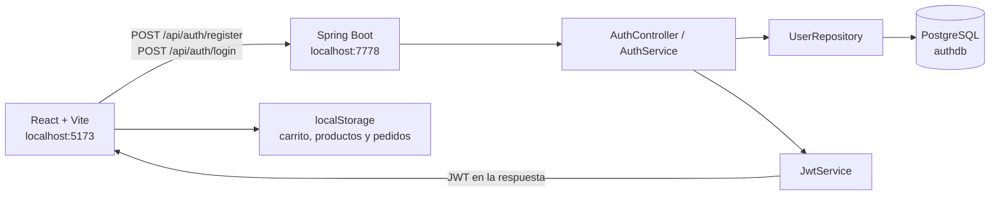

# AkumaTech — tienda gamer

Aplicación académica Fullstack II para una tienda de productos tecnológicos y gamer. El proyecto tiene una interfaz React/Vite en la rama `main` y un backend Spring Boot en la rama `backend-axel`. La autenticación del frontend ya consume los endpoints de registro e inicio de sesión del backend.

> **Estado actual:** la integración frontend-backend cubre registro y login. Los datos del catálogo, el carrito y los pedidos todavía se gestionan localmente en el navegador; no hay una API de productos o pedidos implementada.

## Contenidos

- [Funcionalidades](#funcionalidades)
- [Arquitectura e integración](#arquitectura-e-integración)
- [Tecnologías y requisitos](#tecnologías-y-requisitos)
- [Ejecución del backend](#ejecución-del-backend)
- [Ejecución del frontend](#ejecución-del-frontend)
- [API de autenticación](#api-de-autenticación)
- [Pruebas con Postman](#pruebas-con-postman)
- [Persistencia](#persistencia)
- [Pruebas automatizadas](#pruebas-automatizadas)
- [Estructura del backend](#estructura-del-backend)
- [Limitaciones y seguridad](#limitaciones-y-seguridad)

## Funcionalidades

### Frontend

- Catálogo inicial de productos gamer y componentes.
- Carrusel de ofertas, carrito persistente, descuentos y modalidades de envío.
- Registro con campos de nombre, RUT, correo, contraseña y teléfono.
- Inicio y cierre de sesión desde la interfaz.
- Historial y reposición de pedidos.
- Vistas administrativas para estadísticas, productos y usuarios.
- Diseño adaptable y pruebas de componentes, contextos, validaciones y accesibilidad.

### Backend

- Registro de usuarios y login mediante API REST.
- Contraseñas almacenadas con BCrypt.
- Emisión de JWT con el correo como sujeto y expiración configurable (24 horas por defecto).
- Persistencia de usuarios en PostgreSQL con Spring Data JPA y migraciones Flyway.
- Desactivación lógica de usuarios mediante un endpoint de eliminación.
- CORS habilitado para los orígenes locales de Vite indicados en la configuración.

## Arquitectura e integración



El frontend envía `email` y `password` al backend. Aunque el formulario de registro presenta otros campos, el backend actual no recibe ni guarda nombre, RUT o teléfono. Después del login, el frontend guarda el token y crea su sesión local.

El proyecto está organizado en ramas separadas:

- `main`: frontend React/Vite.
- `backend-axel`: backend Spring Boot.

Para desarrollar ambas partes a la vez, se pueden clonar/abrir en carpetas distintas y mantener activos ambos servidores.

## Tecnologías y requisitos

| Componente | Tecnología |
|---|---|
| Backend | Java 27, Spring Boot 4.1.2, Gradle Wrapper 9.9.1 |
| Persistencia backend | PostgreSQL, Spring Data JPA, Flyway |
| Seguridad y autenticación | Spring Security, BCrypt, JJWT 0.12.6 |
| Frontend | React 19, JavaScript, Vite 8 |
| Pruebas frontend | Vitest, Testing Library, jest-axe |

Necesitas un JDK compatible con Java 27 para el backend. Para el frontend, instala Node.js y npm. PostgreSQL debe estar instalado y ejecutándose; en los comandos siguientes se usa el puerto `5432`.

## Ejecución del backend

### 1. Obtener la rama

Desde PowerShell:

```powershell
git clone -b backend-axel https://github.com/axbrogi23/AkumaTech_SpringBoot.git AkumaTech-backend
cd AkumaTech-backend
```

Si ya tienes el repositorio, cambia a la carpeta que contiene `build.gradle` y `gradlew.bat`.

### 2. Preparar PostgreSQL

Inicia el servicio de PostgreSQL y conéctate a la base administrativa `postgres`, por ejemplo:

```powershell
psql -h localhost -p 5432 -U postgres -d postgres
```

Dentro de `psql`, crea el usuario y la base de datos. Establece la contraseña de forma interactiva para no dejarla escrita en el historial:

```sql
CREATE ROLE authuser WITH LOGIN;
\password authuser
CREATE DATABASE authdb OWNER authuser;
```

Si el rol ya existe, usa `ALTER ROLE authuser WITH LOGIN;` en lugar de `CREATE ROLE`. El puerto, usuario, contraseña y nombre de base deben coincidir con la configuración que use el backend.

### 3. Configurar credenciales

No guardes contraseñas ni secretos JWT en Git. Spring Boot permite sobrescribir las propiedades mediante variables de entorno. En PowerShell, configúralas en la misma terminal desde la que iniciarás Gradle:

```powershell
$env:SPRING_DATASOURCE_URL = "jdbc:postgresql://localhost:5432/authdb"
$env:SPRING_DATASOURCE_USERNAME = "authuser"
$env:SPRING_DATASOURCE_PASSWORD = "<contraseña-local>"
$env:SPRING_FLYWAY_URL = "jdbc:postgresql://localhost:5432/authdb"
$env:SPRING_FLYWAY_USER = "authuser"
$env:SPRING_FLYWAY_PASSWORD = "<contraseña-local>"
$env:SECURITY_JWT_SECRET = "<secreto-largo-y-aleatorio>"
```

No publiques esos valores ni los incluyas en capturas. Las variables solo permanecen en esa sesión de PowerShell.

### 4. Compilar e iniciar

```powershell
.\gradlew.bat classes
.\gradlew.bat bootRun
```

El backend escucha en `http://localhost:7778`. Deja la terminal abierta mientras haces pruebas. Para detenerlo, presiona `Ctrl + C`.

## Ejecución del frontend

Clona la rama `main` en otra carpeta o usa tu checkout del frontend:

```powershell
git clone -b main https://github.com/axbrogi23/AkumaTech_SpringBoot.git AkumaTech-frontend
cd AkumaTech-frontend
npm ci
npm run dev
```

Vite muestra la dirección local en la terminal, normalmente `http://localhost:5173`. El frontend usa por defecto la API en `http://localhost:7778/api/auth`. Para cambiarla, crea `.env.local` en la raíz del frontend:

```env
VITE_API_URL=http://localhost:7778/api/auth
```

El backend permite CORS para `localhost` y `127.0.0.1` en los puertos `5173` y `4173`.

## API de autenticación

Base URL local: `http://localhost:7778/api/auth`

| Método | Ruta | Uso |
|---|---|---|
| `POST` | `/register` | Registra un usuario y devuelve un JWT. |
| `POST` | `/login` | Valida credenciales y devuelve un JWT. |
| `DELETE` | `/delete/{email}` | Marca como inactivo al usuario asociado al correo. |

Los endpoints de registro y login reciben JSON con correo válido y contraseña no vacía:

```json
{
  "email": "usuario@example.com",
  "password": "Cambiar123!"
}
```

Respuesta de registro o login:

```json
{
  "token": "<jwt>"
}
```

Comportamiento esperado:

- Registro exitoso: respuesta con token.
- Correo ya registrado: `409 Conflict`.
- Login con usuario o contraseña incorrectos: `401 Unauthorized`.
- Usuario inexistente al eliminar: `404 Not Found`.

## Pruebas con Postman

La colección [AkumaTech-Auth.postman_collection.json](./AkumaTech-Auth.postman_collection.json) se puede importar desde **Postman → Import → Files**. Incluye solicitudes de registro y login, y variables editables:

- `baseUrl`: dirección base de la API local.
- `testEmail`: correo de prueba.
- `testPassword`: contraseña de prueba.

Usa un correo nuevo para probar el registro. Si ya existe, prueba el login con esas credenciales o cambia `testEmail`. No guardes tokens reales ni contraseñas personales en una colección que vayas a compartir.

También se pueden probar las solicitudes en `src/main/java/com/akuma/tech/auth/client.http` desde un cliente compatible con archivos `.http`; reemplaza sus datos de ejemplo por valores de prueba.

## Persistencia

El backend persiste usuarios en la tabla `users`. El modelo Java incluye identificador, nombre de usuario, correo, contraseña codificada y estado activo. En el registro actual, el correo también se asigna como nombre de usuario.

Flyway ejecuta migraciones ubicadas en `src/main/resources/db/migration`. JPA tiene `spring.jpa.hibernate.ddl-auto=update` en la configuración local. Para despliegues reales, conviene administrar cambios de esquema con migraciones revisadas y evitar actualizar automáticamente el esquema.

En el frontend, `localStorage` conserva la sesión y el token, carrito, productos administrados localmente e historial de pedidos. Esos datos no se sincronizan con tablas del backend salvo el correo/contraseña usados por la autenticación.

## Pruebas automatizadas

Desde la carpeta del backend:

```powershell
.\gradlew.bat test
```

El backend incluye una prueba de carga del contexto de Spring. Puede requerir que PostgreSQL y las credenciales de prueba estén configurados.

Desde la carpeta del frontend:

```powershell
npm test
npm run test:coverage
npm run lint
```

El frontend genera el reporte de cobertura en `coverage/`.

## Estructura del backend

```text
src/
├── main/
│   ├── java/com/akuma/tech/
│   │   ├── TechApplication.java
│   │   └── auth/
│   │       ├── config/SecurityConfig.java
│   │       ├── controller/AuthController.java
│   │       ├── dto/
│   │       │   ├── AuthResponse.java
│   │       │   ├── LoginRequest.java
│   │       │   └── RegisterRequest.java
│   │       ├── model/User.java
│   │       ├── repository/UserRepository.java
│   │       └── service/
│   │           ├── AuthService.java
│   │           └── JwtService.java
│   └── resources/
│       ├── application.properties
│       └── db/migration/V1_Create_user_table.sql
└── test/java/com/akuma/tech/TechApplicationTests.java
```

## Limitaciones y seguridad

- Spring Security actualmente permite todas las solicitudes (`permitAll`). El endpoint de eliminación no requiere autenticación y no debe exponerse a Internet.
- El backend genera JWT, pero todavía no valida esos tokens en un filtro ni los utiliza para proteger rutas.
- El rol `admin` y las operaciones administrativas del frontend son locales; el backend no implementa autorización por roles.
- Productos, carrito y pedidos todavía no tienen persistencia ni API en el backend.
- La migración inicial declara la columna `password_hash`, mientras que la entidad JPA mapea el campo `password` con el nombre predeterminado. Revisa y alinea el esquema/mapeo antes de crear una base de datos nueva exclusivamente a partir de esa migración.
- No uses la configuración local ni credenciales de prueba en producción. Antes de desplegar, guarda secretos en variables de entorno/gestor de secretos, usa HTTPS, protege todos los endpoints y revisa las migraciones.
