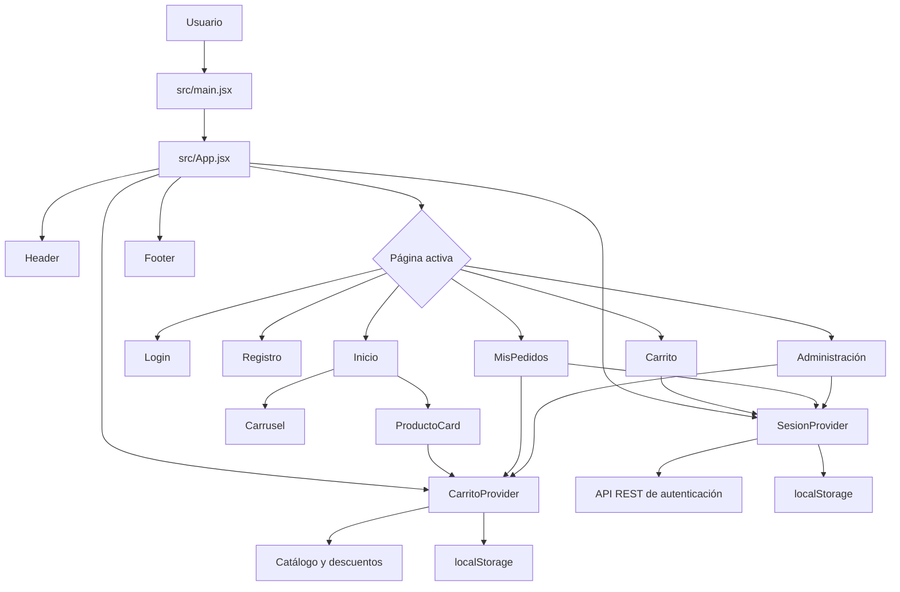
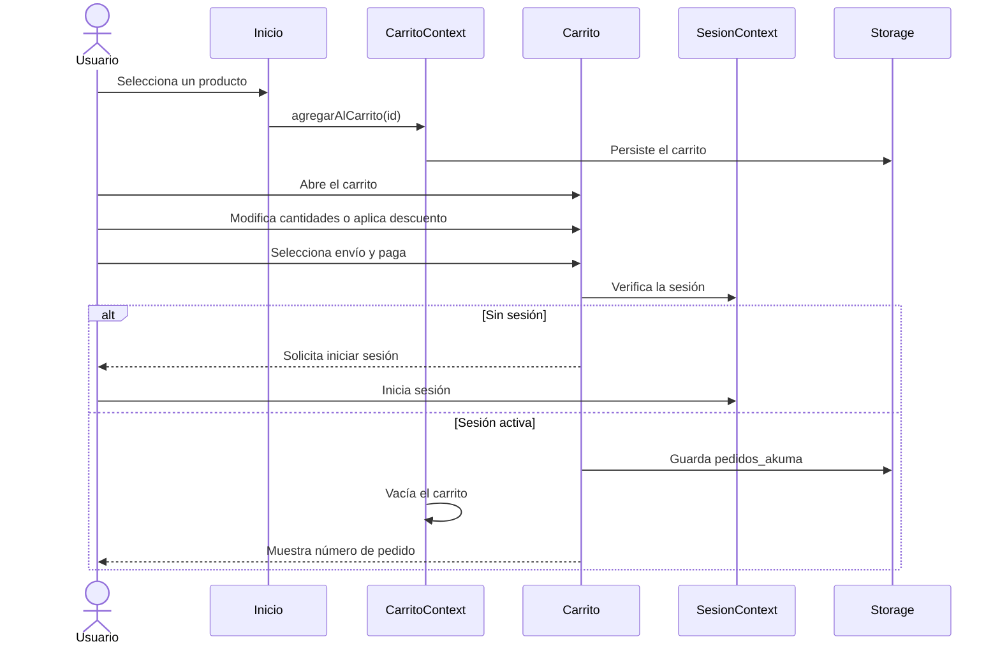

# AkumaTech - Tienda Gamer


Aplicación web de una tienda de productos tecnológicos y gamer. Permite explorar un catálogo, agregar productos al carrito, aplicar descuentos, seleccionar envío, iniciar sesión, registrar usuarios, consultar pedidos y acceder a herramientas administrativas.

Proyecto desarrollado para **Fullstack II - Duoc UC** con una interfaz construida en React y un backend independiente.

## Tabla de contenidos

- [Características](#características)
- [Arquitectura de la aplicación](#arquitectura-de-la-aplicación)
- [Navegación y páginas](#navegación-y-páginas)
- [Flujo de compra](#flujo-de-compra)
- [Autenticación y autorización](#autenticación-y-autorización)
- [Estado y persistencia](#estado-y-persistencia)
- [Estructura del proyecto](#estructura-del-proyecto)
- [Stack tecnológico](#stack-tecnológico)
- [Requisitos](#requisitos)
- [Instalación y ejecución](#instalación-y-ejecución)
- [Configuración del backend](#configuración-del-backend)
- [Catálogo y promociones](#catálogo-y-promociones)
- [Pruebas](#pruebas)
- [Scripts disponibles](#scripts-disponibles)
- [Documentación adicional](#documentación-adicional)
- [Notas de implementación](#notas-de-implementación)

## Características

- Catálogo de 14 productos gamer y componentes de hardware.
- Carrusel de ofertas en la página de inicio.
- Carrito persistente con cantidades, subtotal y total.
- Códigos de descuento y tres modalidades de envío.
- Registro con validación de nombre, RUT chileno, correo, contraseña y teléfono.
- Inicio de sesión mediante una API REST.
- Historial de pedidos asociado al correo del usuario.
- Reposición de pedidos anteriores al carrito.
- Panel de administración con estadísticas.
- Gestión de productos y usuarios.
- Diseño adaptable para escritorio y dispositivos móviles.
- Pruebas de componentes, contextos, rutas, validaciones y accesibilidad.

## Arquitectura de la aplicación

La interfaz sigue una arquitectura basada en componentes de React y contextos globales. No utiliza React Router: `App.jsx` administra el identificador de la página activa y pasa la función `navegar` a las vistas y componentes.



### Responsabilidades principales

| Capa | Responsabilidad |
|---|---|
| `main.jsx` | Crea el árbol React e inicializa la aplicación. |
| `App.jsx` | Compone la aplicación y controla la navegación interna mediante estado. |
| `components/` | Renderiza elementos reutilizables como navegación, pie de página, carrusel y tarjeta de producto. |
| `pages/` | Implementa las vistas completas de la aplicación. |
| `context/` | Comparte sesión y estado del carrito entre componentes. |
| `data/` | Contiene el catálogo inicial, descuentos y opciones de envío. |
| `utils/` | Centraliza validaciones chilenas y operaciones de `localStorage`. |
| `tests/` | Verifica componentes, contextos, navegación y accesibilidad. |

## Navegación y páginas

La navegación actual usa valores de estado como `inicio`, `login`, `registro`, `carrito`, `mis-pedidos`, `admin`, `admin-productos` y `admin-usuarios`.

| Página o componente | Identificador | Función |
|---|---|---|
| Inicio | `inicio` | Muestra carrusel y catálogo. |
| Login | `login` | Valida credenciales y obtiene el token de autenticación. |
| Registro | `registro` | Registra un usuario mediante la API. |
| Carrito | `carrito` | Gestiona cantidades, envío, descuento y pedido. |
| MisPedidos | `mis-pedidos` | Consulta pedidos del usuario autenticado. |
| Admin | `admin` | Muestra estadísticas y acciones administrativas. |
| AdminProductos | `admin-productos` | Crea, modifica y elimina productos. |
| AdminUsuarios | `admin-usuarios` | Crea, modifica y elimina usuarios locales. |
| Header | - | Navegación, sesión activa y contador del carrito. |
| Footer | - | Información y enlaces de la tienda. |
| Carrusel | - | Presenta promociones rotativas. |
| ProductoCard | - | Presenta producto y permite agregarlo al carrito. |

## Flujo de compra



El checkout exige una sesión activa. Luego genera un número de pedido y guarda el pedido en `localStorage` bajo `pedidos_akuma`. El carrito se vacía después de completar la operación.

## Autenticación y autorización

`SesionContext` expone:

- `sesion`: usuario autenticado.
- `usuarios`: usuarios mantenidos localmente.
- `iniciarSesion(correo, password)`: realiza el login contra la API.
- `registrarUsuario(datos)`: realiza el registro contra la API.
- `cerrarSesion()`: elimina sesión y token.
- `esAdmin()`: verifica si el rol de sesión es `admin`.
- `guardarUsuarios(lista)`: guarda y actualiza usuarios locales.

El registro envía `email` y `password` a la API. El login recibe un token y construye una sesión local con nombre derivado del correo y rol `usuario`.

Las páginas administrativas deben mostrar acceso restringido si no existe una sesión con rol `admin`.

## Estado y persistencia

La aplicación usa `React Context` para compartir información y `localStorage` para mantener datos entre recargas.

| Clave | Contenido |
|---|---|
| `sesionActiva` | Sesión visible por la aplicación. |
| `akuma_token` | Token recibido desde el backend. |
| `carrito` | Productos, precio e cantidad del carrito. |
| `productos` | Catálogo administrable por la interfaz. |
| `usuarios` | Usuarios utilizados por las funciones administrativas locales. |
| `pedidos_akuma` | Historial de pedidos realizado desde el frontend. |

Las funciones `leerStorage`, `guardarStorage` y `eliminarStorage` encapsulan la lectura y escritura de datos JSON.

> El almacenamiento en el navegador es adecuado para una entrega académica o prototipo. Para producción, usuarios, roles, productos y pedidos deberían gestionarse íntegramente por el backend.

## Estructura del proyecto

```text
Akuma_tech_React-main/
├── public/
│   └── Recursos públicos de imagen y video
├── src/
│   ├── assets/
│   │   └── Imágenes importadas por Vite
│   ├── components/
│   │   ├── Carrusel.jsx
│   │   ├── Footer.jsx
│   │   ├── Header.jsx
│   │   └── ProductoCard.jsx
│   ├── context/
│   │   ├── CarritoContext.jsx
│   │   └── SesionContext.jsx
│   ├── data/
│   │   └── productos.js
│   ├── pages/
│   │   ├── Admin.jsx
│   │   ├── AdminProductos.jsx
│   │   ├── AdminUsuarios.jsx
│   │   ├── Carrito.jsx
│   │   ├── Inicio.jsx
│   │   ├── Login.jsx
│   │   ├── MisPedidos.jsx
│   │   └── Registro.jsx
│   ├── tests/
│   │   └── Pruebas de componentes, contexto y flujos
│   ├── utils/
│   │   ├── storage.js
│   │   └── validaciones.js
│   ├── App.jsx
│   ├── App.css
│   ├── index.css
│   ├── main.jsx
│   └── setupTests.js
├── diagrama_arquitectura.md
├── diagrama_de_flujo.md
├── package.json
├── vite.config.js
└── README.md
```

## Stack tecnológico

| Área | Tecnología |
|---|---|
| Biblioteca UI | React 19 |
| Empaquetador | Vite 8 |
| Lenguaje | JavaScript y JSX |
| Estado | React Context y hooks |
| Persistencia | `localStorage` |
| Estilos | CSS3 |
| Pruebas | Vitest, Testing Library y jest-axe |
| Cobertura | @vitest/coverage-v8 |

## Requisitos

- Node.js 18 o superior.
- npm 9 o superior.
- Un backend REST disponible para registro e inicio de sesión.

## Instalación y ejecución

```powershell
git clone <URL_DEL_REPOSITORIO>
cd Akuma_tech_React-main
npm install
npm run dev
```

Vite iniciará la aplicación y mostrará la dirección local en la terminal, normalmente `http://localhost:5173`.

Para generar y revisar una compilación de producción:

```powershell
npm run build
npm run preview
```

## Configuración del backend

Por defecto, el frontend consulta:

```text
http://localhost:7778/api/auth
```

Para usar otra dirección, crea `.env.local` en la raíz:

```env
VITE_API_URL=http://localhost:7778/api/auth
```

El contexto de sesión espera estos endpoints:

| Método | Ruta | Descripción |
|---|---|---|
| `POST` | `/register` | Registra el usuario. |
| `POST` | `/login` | Valida credenciales y devuelve un token. |

Ejemplo conceptual del login:

```json
{
  "email": "usuario@gmail.com",
  "password": "1234"
}
```

Respuesta esperada:

```json
{
  "token": "jwt-o-token-generado"
}
```

El nombre del repositorio puede contener documentación del backend anterior. Si se elimina esa implementación, actualiza esta sección y elimina los archivos de `backend/`.

## Catálogo y promociones

El catálogo inicial se encuentra en `src/data/productos.js`.

| Código | Descuento |
|---|---|
| `AKUMA10` | 10% |
| `GAMER30` | 30% |
| `BIENVENIDO15` | 15% |
| `DESCUENTO5` | 5% |
| `CYBERAKUMA40` | 40% |

Las opciones de envío son:

| Método | Precio |
|---|---|
| Estándar | Gratis |
| Express | $4.990 |
| Same Day | $9.990 |

## Pruebas

```powershell
npm test
npm run test:watch
npm run test:coverage
```

El proyecto incluye pruebas para:

- Validación de correo, contraseña, RUT y teléfono.
- Lectura y escritura de `localStorage`.
- Operaciones del carrito y descuentos.
- Registro e inicio de sesión.
- Renderizado de componentes.
- Navegación entre vistas.
- Formularios y acciones del usuario.
- CRUD de productos y usuarios.
- Accesibilidad con `jest-axe`.

El reporte HTML de cobertura se genera en `coverage/index.html`.

## Scripts disponibles

| Comando | Acción |
|---|---|
| `npm run dev` | Inicia Vite con recarga automática. |
| `npm run build` | Genera la versión de producción en `dist/`. |
| `npm run preview` | Sirve localmente la compilación de producción. |
| `npm run lint` | Ejecuta ESLint. |
| `npm test` | Ejecuta Vitest una sola vez. |
| `npm run test:watch` | Ejecuta pruebas en modo observación. |
| `npm run test:coverage` | Genera el informe de cobertura. |

## Documentación adicional

- [Arquitectura detallada](./diagrama_arquitectura.md)
- [Flujos de navegación y compra](./diagrama_de_flujo.md)

## Notas de implementación

- La navegación es controlada por estado dentro de `App.jsx`; no existe configuración de React Router.
- Los datos comerciales se almacenan localmente en el navegador.
- Las imágenes alojadas externamente requieren conexión a Internet.
- `node_modules/`, `dist/` y `coverage/` están excluidos por `.gitignore`.
- El administrador por defecto utiliza `admin@gmail.com` y `admin123`, pero debe reemplazarse o gestionarse de forma segura al integrar un backend real.
