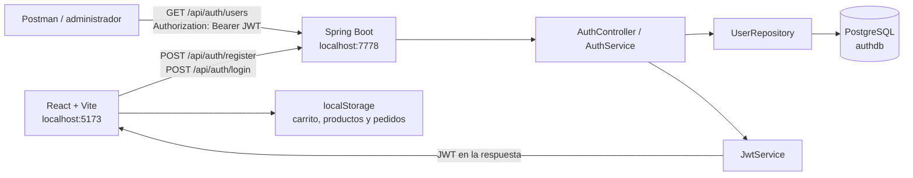

# 🎮 AkumaTech — tienda gamer

**Aplicación académica Fullstack II** para una tienda de productos tecnológicos y gamer.

| Frontend | Backend | Persistencia |
|---|---|---|
| React + Vite (`main`) | Spring Boot (`backend-axel`) | PostgreSQL |

La autenticación del frontend ya consume los endpoints de registro e inicio de sesión del backend.

> **Estado actual:** la integración cubre registro y login desde el frontend, además de consulta y desactivación de usuarios para cuentas administradoras. El catálogo, el carrito y los pedidos se gestionan localmente en el navegador; todavía no existe una API para productos o pedidos.

## 🧭 Contenido

| Proyecto | Desarrollo | Datos y pruebas |
|---|---|---|
| [Funcionalidades](#funcionalidades) | [Tecnologías y requisitos](#tecnologías-y-requisitos) | [API de autenticación](#api-de-autenticación) |
| [Arquitectura e integración](#arquitectura-e-integración) | [Ejecución del backend](#ejecución-del-backend) | [Pruebas con Postman y REST Client](#pruebas-con-postman-y-rest-client) |
| [Estructura del backend](#estructura-del-backend) | [Ejecución del frontend](#ejecución-del-frontend) | [Persistencia](#persistencia) |
| [Limitaciones y seguridad](#limitaciones-y-seguridad) | [Pruebas automatizadas](#pruebas-automatizadas) | |

## Funcionalidades

### Frontend

- Catálogo inicial de productos gamer y componentes.
- Carrusel de ofertas, carrito persistente, descuentos y modalidades de envío.
- Registro con campos de nombre, RUT, correo, contraseña y teléfono.
- Inicio y cierre de sesión desde la interfaz.
- Historial y reposición de pedidos.
- Vistas administrativas para estadísticas, productos y usuarios.
- Diseño adaptable y pruebas de componentes, contextos, validaciones y accesibilidad.

### Backend

- Registro de usuarios y login mediante API REST.
- Contraseñas almacenadas con BCrypt.
- Emisión de JWT con el correo como sujeto y expiración configurable (24 horas por defecto).
- Persistencia de usuarios en PostgreSQL con Spring Data JPA y migraciones Flyway.
- Listado de usuarios sin exponer contraseñas; restringido a administradores.
- Desactivación lógica de usuarios mediante un endpoint de eliminación.
- CORS habilitado para los orígenes locales de Vite indicados en la configuración.

## Arquitectura e integración



El frontend envía `email` y `password` al backend. Aunque el formulario de registro presenta otros campos, el backend actual no recibe ni guarda nombre, RUT o teléfono. Después del login, el frontend guarda el token y crea su sesión local.

El proyecto está organizado en ramas separadas:

- `main`: frontend React/Vite.
- `backend-axel`: backend Spring Boot.

Para desarrollar ambas partes a la vez, se pueden clonar/abrir en carpetas distintas y mantener activos ambos servidores.

## Tecnologías y requisitos

| Componente | Tecnología |
|---|---|
| Backend | Java 27, Spring Boot 4.1.2, Gradle Wrapper 9.9.1 |
| Persistencia backend | PostgreSQL, Spring Data JPA, Flyway (Spring Boot starter y módulo PostgreSQL) |
| Seguridad y autenticación | Spring Security, BCrypt, JJWT 0.12.6 |
| Frontend | React 19, JavaScript, Vite 8 |
| Pruebas frontend | Vitest, Testing Library, jest-axe |

Necesitas un JDK compatible con Java 27 para el backend. Para el frontend, instala Node.js y npm. PostgreSQL debe estar instalado y ejecutándose; en los comandos siguientes se usa el puerto `5432`.

## Ejecución del backend

### 1. 📥 Obtener la rama

Desde PowerShell:

```powershell
git clone -b backend-axel https://github.com/axbrogi23/AkumaTech_SpringBoot.git AkumaTech-backend
cd AkumaTech-backend
```

Si ya tienes el repositorio, cambia a la carpeta que contiene `build.gradle` y `gradlew.bat`.

### 2. 🐘 Preparar PostgreSQL

Inicia el servicio de PostgreSQL y conéctate a la base administrativa `postgres`, por ejemplo:

```powershell
psql -h localhost -p 5432 -U postgres -d postgres
```

Dentro de `psql`, crea el usuario y la base de datos. Establece la contraseña de forma interactiva para no dejarla escrita en el historial:

```sql
CREATE ROLE authuser WITH LOGIN;
\password authuser
CREATE DATABASE authdb OWNER authuser;
```

Si el rol ya existe, usa `ALTER ROLE authuser WITH LOGIN;` en lugar de `CREATE ROLE`. El puerto, usuario, contraseña y nombre de base deben coincidir con la configuración que use el backend.

### 3. 🔐 Configurar credenciales

No guardes contraseñas ni secretos JWT en Git. Spring Boot permite sobrescribir las propiedades mediante variables de entorno. En PowerShell, configúralas en la misma terminal desde la que iniciarás Gradle:

```powershell
$env:SPRING_DATASOURCE_URL = "jdbc:postgresql://localhost:5432/authdb"
$env:SPRING_DATASOURCE_USERNAME = "authuser"
$env:SPRING_DATASOURCE_PASSWORD = "<contraseña-local>"
$env:SPRING_FLYWAY_URL = "jdbc:postgresql://localhost:5432/authdb"
$env:SPRING_FLYWAY_USER = "authuser"
$env:SPRING_FLYWAY_PASSWORD = "<contraseña-local>"
$env:SECURITY_JWT_SECRET = "<secreto-largo-y-aleatorio>"
```

No publiques contraseñas ni secretos. Las variables solo permanecen en esa sesión de PowerShell.

### 4. ▶️ Compilar e iniciar

```powershell
.\gradlew.bat classes
.\gradlew.bat bootRun
```

El backend escucha en `http://localhost:7778`. Deja la terminal abierta mientras haces pruebas. Para detenerlo, presiona `Ctrl + C`.

## Ejecución del frontend

Clona la rama `main` en otra carpeta o usa tu checkout del frontend:

```powershell
git clone -b main https://github.com/axbrogi23/AkumaTech_SpringBoot.git AkumaTech-frontend
cd AkumaTech-frontend
npm ci
npm run dev
```

`npm ci` instala las dependencias del proyecto usando las versiones fijadas en `package-lock.json`. `npm run dev` inicia el servidor de desarrollo; Vite muestra la dirección local en la terminal, normalmente `http://localhost:5173`.

El frontend usa por defecto la API en `http://localhost:7778/api/auth`. Para cambiarla, crea `.env.local` en la raíz del frontend:

```env
VITE_API_URL=http://localhost:7778/api/auth
```

El backend permite CORS para `localhost` y `127.0.0.1` en los puertos `5173` y `4173`.

## API de autenticación

Base URL local: `http://localhost:7778/api/auth`

| Método | Ruta | Uso |
|---|---|---|
| `POST` | `/register` | Registra un usuario y devuelve un JWT. |
| `POST` | `/login` | Valida credenciales y devuelve un JWT. |
| `GET` | `/users` | Lista usuarios (id, username, email y estado activo); requiere JWT de administrador. |
| `DELETE` | `/delete/{email}` | Desactiva al usuario asociado al correo; no elimina el registro de la base de datos. |

Las cuentas nuevas son usuarios normales. Para habilitar una cuenta administradora, primero regístrala y luego, conectado a la base `authdb` como administrador de PostgreSQL, ejecuta:

```sql
UPDATE users SET admin = TRUE WHERE email = 'admin@example.com';
```

Inicia sesión con esa cuenta y copia el token de la respuesta. En Postman, configura la variable `adminToken` de la colección con ese JWT. El endpoint `GET http://localhost:7778/api/auth/users` requiere el encabezado `Authorization: Bearer <token>` y devuelve solo id, username, email y estado activo; nunca incluye contraseñas. Una solicitud sin token responde `401`; una cuenta normal responde `403`.

Los endpoints de registro y login reciben JSON con correo válido y contraseña no vacía:

```json
{
  "email": "usuario@example.com",
  "password": "Cambiar123!"
}
```

Respuesta de registro o login:

```json
{
  "token": "<jwt>"
}
```

Comportamiento esperado:

- Registro exitoso: respuesta con token.
- Correo ya registrado: `409 Conflict`.
- Login con usuario o contraseña incorrectos: `401 Unauthorized`.
- Usuario inexistente al eliminar: `404 Not Found`.

## Pruebas con Postman y REST Client

La colección [AkumaTech-Auth.postman_collection.json](./AkumaTech-Auth.postman_collection.json) se puede importar desde **Postman → Import → Files**. Incluye solicitudes para registrar, iniciar sesión, listar usuarios y desactivar un usuario. Usa estas variables editables:

- `baseUrl`: dirección base de la API local.
- `testEmail`: correo de prueba.
- `testPassword`: contraseña de prueba.
- `adminToken`: JWT de una cuenta promovida a administradora en PostgreSQL; se envía en el encabezado Bearer para listar o desactivar usuarios.

> **Flujo recomendado:** registra una cuenta, promuévela manualmente a administradora con el SQL de la sección anterior si necesitas consultar usuarios, inicia sesión y pega el JWT en `adminToken`. Para eliminar usuarios usa la solicitud de eliminación solo cuando quieras desactivarlos. Si vuelves a registrar un correo existente, la API responde `409 Conflict`.

> **Seguridad:** no guardes tokens reales ni contraseñas personales en una colección que vayas a compartir.

También puedes usar [client.http](./client.http) desde VS Code con la extensión **REST Client** para probar registro, login, listado y desactivación. Edita sus variables de ejemplo. Las solicitudes de listado y desactivación reutilizan automáticamente el JWT de la solicitud `login`; la cuenta debe tener `admin = TRUE` en PostgreSQL. Usa una cuenta desechable para probar la desactivación.

## Persistencia

El backend persiste usuarios en la tabla `users`. El modelo Java incluye identificador, nombre de usuario, correo, contraseña codificada y estado activo. En el registro actual, el correo también se asigna como nombre de usuario.

Flyway ejecuta migraciones ubicadas en `src/main/resources/db/migration`: `V1__Create_user_table.sql` crea el esquema inicial y `V2__Add_admin_flag.sql` agrega el indicador de administrador. Los nombres siguen la convención de Flyway `V<N>__<descripcion>.sql`. Para bases existentes sin historial de Flyway, `baseline-on-migrate` toma la versión 1 como base y aplica las migraciones posteriores pendientes. JPA tiene `spring.jpa.hibernate.ddl-auto=update` en la configuración local; para despliegues reales conviene administrar cambios de esquema con migraciones revisadas.

En el frontend, `localStorage` conserva la sesión y el token, carrito, productos administrados localmente e historial de pedidos. Esos datos no se sincronizan con tablas del backend salvo el correo/contraseña usados por la autenticación.

## Pruebas automatizadas

Desde la carpeta del backend:

```powershell
.\gradlew.bat test
```

El backend incluye pruebas de carga del contexto de Spring y del filtro JWT para comprobar la asignación de roles de administrador/usuario y el rechazo de tokens inválidos. Las pruebas de contexto necesitan PostgreSQL y las credenciales de prueba configurados.

Desde la carpeta del frontend:

```powershell
npm test
npm run test:coverage
npm run lint
```

El frontend genera el reporte de cobertura en `coverage/`.

## Estructura del backend

```text
src/
├── main/
│   ├── java/com/akuma/tech/
│   │   ├── TechApplication.java
│   │   └── auth/
│   │       ├── config/SecurityConfig.java
│   │       ├── config/JwtAuthenticationFilter.java
│   │       ├── controller/AuthController.java
│   │       ├── dto/
│   │       │   ├── AuthResponse.java
│   │       │   ├── LoginRequest.java
│   │       │   ├── RegisterRequest.java
│   │       │   └── UserResponse.java
│   │       ├── model/User.java
│   │       ├── repository/UserRepository.java
│   │       └── service/
│   │           ├── AuthService.java
│   │           └── JwtService.java
│   └── resources/
│       ├── application.properties
│       └── db/migration/
│           ├── V1__Create_user_table.sql
│           └── V2__Add_admin_flag.sql
└── test/java/com/akuma/tech/
    ├── TechApplicationTests.java
    └── auth/config/JwtAuthenticationFilterTest.java
```

## Limitaciones y seguridad

- **Acceso:** el listado y la desactivación de usuarios requieren un JWT de una cuenta con rol administrador. Los endpoints de registro y login son públicos.
- **JWT:** los tokens se validan en el filtro de autenticación; actualmente se usan para autorizar el listado y la desactivación de usuarios.
- **Roles:** las cuentas nuevas se crean como usuarios normales. Una cuenta debe promoverse manualmente en PostgreSQL para obtener el rol administrador; no existe administración de roles desde una API.
- **Datos:** productos, carrito y pedidos todavía no tienen persistencia ni API en el backend.
- **Producción:** no uses la configuración local ni credenciales de prueba. Antes de desplegar, guarda secretos en variables de entorno o un gestor de secretos, usa HTTPS, protege todos los endpoints y revisa las migraciones.
