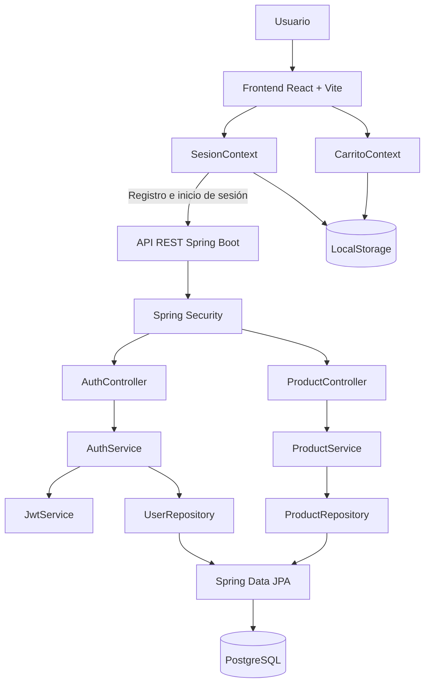

# 🎮 AkumaTech – Tienda Gamer


**AkumaTech** es una aplicación web de comercio electrónico enfocada en la venta de productos tecnológicos, componentes de computador y accesorios gaming.

El proyecto fue desarrollado para la asignatura Fullstack II de Duoc UC y utiliza una arquitectura Full Stack, compuesta por un frontend desarrollado con React y una API REST desarrollada con Java y Spring Boot.

La aplicación permite visualizar productos, gestionar un carrito de compras, aplicar descuentos, registrarse, iniciar sesión y acceder a funcionalidades administrativas.

El backend proporciona servicios de autenticación, administración de usuarios y gestión de productos mediante operaciones CRUD, utilizando PostgreSQL como sistema de almacenamiento.

---

## 📋 Tabla de contenidos

- [Características principales](#-características-principales)
- [Tecnologías utilizadas](#-tecnologías-utilizadas)
- [Arquitectura del sistema](#-arquitectura-del-sistema)
- [Estructura del proyecto](#-estructura-del-proyecto)
- [Requisitos previos](#-requisitos-previos)
- [Instalación y ejecución](#-instalación-y-ejecución)
- [Configuración del frontend](#-configuración-del-frontend)
- [API REST](#-api-rest)
- [CRUD de usuarios](#-crud-de-usuarios)
- [CRUD de productos](#-crud-de-productos)
- [Base de datos](#-base-de-datos)
- [Persistencia de datos](#-persistencia-de-datos)
- [Pruebas](#-pruebas)
- [Scripts disponibles](#-scripts-disponibles)
- [Repositorios relacionados](#-repositorios-relacionados)

---

## 🚀 Características principales

### 🛒 Catálogo de productos
- Catálogo inicial de 14 productos gamer y componentes de hardware.
- Visualización de productos con imágenes, precios y descripciones.
- Productos destacados y carrusel de ofertas.
- Organización de información de productos.

### 🛍️ Carrito de compras
- Agregar productos al carrito.
- Incrementar y disminuir cantidades.
- Eliminar productos.
- Cálculo automático de subtotales y total.
- Aplicación de códigos promocionales.
- Selección de modalidades de envío:
  - Estándar.
  - Express.
  - Same Day.

### 🔐 Autenticación de usuarios
- Registro de usuarios.
- Inicio de sesión.
- Validación de credenciales mediante API REST.
- Autenticación basada en JSON Web Token (JWT).
- Almacenamiento seguro de contraseñas mediante BCrypt en el backend.
- Gestión del estado de sesión mediante React Context API.

### 📦 Gestión de pedidos
- Historial de compras.
- Visualización de pedidos realizados.
- Funcionalidad para volver a comprar pedidos anteriores.

### ⚙️ Administración
- Panel administrativo con estadísticas.
- Gestión de productos.
- Gestión de usuarios.
- Operaciones de administración mediante el backend.
- Control de permisos para operaciones protegidas mediante Spring Security.

---

## 🛠️ Tecnologías utilizadas

### Frontend

| Tecnología | Descripción |
|---|---|
| React 19 | Desarrollo de interfaces de usuario. |
| JavaScript | Lógica de programación. |
| JSX | Estructura de componentes. |
| Vite 8 | Herramienta de desarrollo y compilación. |
| React Context API | Administración del estado global. |
| CSS3 | Diseño y estilos de la aplicación. |
| LocalStorage | Persistencia local del navegador. |
| Vitest | Pruebas automatizadas. |
| Testing Library | Pruebas de componentes React. |
| jest-axe | Evaluación de accesibilidad. |
| ESLint | Análisis estático del código. |

### Backend

| Tecnología | Descripción |
|---|---|
| Java 27 | Lenguaje de programación. |
| Spring Boot 4.1.2 | Framework de desarrollo backend. |
| Spring Security | Seguridad y autorización. |
| Spring Data JPA | Persistencia y acceso a datos. |
| PostgreSQL | Base de datos relacional. |
| BCrypt | Codificación de contraseñas. |
| JWT | Autenticación mediante tokens. |
| JJWT 0.12.6 | Implementación de JSON Web Token. |
| Flyway | Administración de migraciones de base de datos. |
| Gradle | Gestión de dependencias y compilación. |

---

## 🏗️ Arquitectura del sistema

AkumaTech utiliza una arquitectura cliente-servidor, donde el frontend se comunica con el backend mediante solicitudes HTTP a través de una API REST.



### Arquitectura del frontend

El frontend utiliza componentes funcionales, hooks y contextos globales para administrar la información de la aplicación.

Sus principales responsabilidades son:

- Presentar la interfaz gráfica.
- Administrar la navegación entre páginas.
- Gestionar el estado de autenticación.
- Administrar el carrito de compras.
- Validar formularios.
- Comunicarse con los servicios del backend.

### Arquitectura del backend

El backend implementa una arquitectura por capas que separa las responsabilidades de cada componente:

| Componente | Responsabilidad |
|---|---|
| Controller | Recibir solicitudes HTTP y entregar respuestas. |
| Service | Ejecutar la lógica de negocio. |
| Repository | Acceder y administrar los datos. |
| Entity | Representar las entidades de la base de datos. |
| DTO | Transportar información entre cliente y servidor. |
| Security | Administrar autenticación y autorización. |
| JwtService | Generar y validar tokens JWT. |

Esta separación facilita el mantenimiento, la organización y la escalabilidad del proyecto.

---

## 📁 Estructura del proyecto

```text
AkumaTech_Frontend/
│
├── public/
│
├── src/
│   ├── assets/
│   │
│   ├── components/
│   │
│   ├── context/
│   │
│   ├── data/
│   │
│   ├── pages/
│   │
│   ├── tests/
│   │
│   ├── utils/
│   │
│   ├── App.jsx
│   ├── App.css
│   ├── index.css
│   ├── main.jsx
│   └── setupTests.js
│
├── .gitignore
├── eslint.config.js
├── index.html
├── package.json
├── package-lock.json
├── vite.config.js
└── README.md
```

### Descripción de las carpetas

| Carpeta / archivo | Función |
|---|---|
| `assets/` | Recursos gráficos e imágenes. |
| `components/` | Componentes reutilizables. |
| `context/` | Contextos globales de sesión y carrito. |
| `data/` | Catálogo inicial, descuentos y envíos. |
| `pages/` | Páginas y vistas de la aplicación. |
| `tests/` | Pruebas automatizadas. |
| `utils/` | Funciones auxiliares y validaciones. |
| `App.jsx` | Composición y navegación principal. |
| `main.jsx` | Punto de entrada de React. |
| `setupTests.js` | Configuración de pruebas. |

---

## 💻 Requisitos previos

Para ejecutar el proyecto completo se necesitan:

- Node.js compatible con Vite 8.
- npm.
- Git.
- Java JDK 27.
- PostgreSQL.
- Visual Studio Code o IntelliJ IDEA (recomendados).

---

## ⚙️ Instalación y ejecución

El proyecto está separado en dos repositorios independientes.

### 1. Clonar el frontend

```bash
git clone https://github.com/axbrogi23/AkumaTech_Frontend.git

cd AkumaTech_Frontend
```

Instalar las dependencias:

```bash
npm install
```

Ejecutar el servidor de desarrollo:

```bash
npm run dev
```

El frontend estará disponible en:

```text
http://localhost:5173
```

### 2. Clonar el backend

Abrir otra terminal:

```bash
git clone https://github.com/axbrogi23/AkumaTech_Backend.git

cd AkumaTech_Backend
```

### 3. Configurar PostgreSQL

El backend utiliza los siguientes valores de conexión de referencia:

| Parámetro | Valor |
|---|---|
| Host | localhost |
| Puerto | 5432 |
| Base de datos | authdb |
| Usuario | authuser |
| Contraseña | Configurada localmente |

Es necesario tener PostgreSQL iniciado y la base de datos creada antes de ejecutar Spring Boot.

Flyway administra las migraciones de las tablas.

### 4. Ejecutar el backend

En Windows PowerShell, configurar las variables de entorno:

```powershell
$env:SPRING_DATASOURCE_URL = "jdbc:postgresql://localhost:5432/authdb"
$env:SPRING_DATASOURCE_USERNAME = "authuser"
$env:SPRING_DATASOURCE_PASSWORD = "TU_PASSWORD"

$env:SPRING_FLYWAY_URL = "jdbc:postgresql://localhost:5432/authdb"
$env:SPRING_FLYWAY_USER = "authuser"
$env:SPRING_FLYWAY_PASSWORD = "TU_PASSWORD"

$env:SECURITY_JWT_SECRET = (New-Guid).ToString() + (New-Guid).ToString() + (New-Guid).ToString()
```

Ejecutar Spring Boot:

```powershell
.\gradlew.bat bootRun
```

El backend estará disponible en:

```text
http://localhost:7778
```

### Orden de ejecución

1. Iniciar PostgreSQL.
2. Iniciar el backend Spring Boot.
3. Iniciar el frontend React.

---

## 🔗 Configuración del frontend

El frontend utiliza una variable de entorno para establecer la dirección de conexión con la API.

Crear un archivo `.env.local` en la raíz del proyecto:

```env
VITE_API_URL=http://localhost:7778/api/auth
```

Esta configuración permite modificar la dirección del backend sin alterar directamente el código fuente.

No subir archivos con credenciales o información privada al repositorio.

---

## 🌐 API REST

El backend dispone de dos módulos principales:

- Autenticación y administración de usuarios.
- Administración de productos.

### Direcciones base

| Servicio | URL |
|---|---|
| API de autenticación | `http://localhost:7778/api/auth` |
| API de productos | `http://localhost:7778/api/products` |

### Endpoints disponibles

| Método | Endpoint | Descripción |
|---|---|---|
| POST | `/api/auth/register` | Registrar usuario. |
| POST | `/api/auth/login` | Iniciar sesión. |
| GET | `/api/auth/users` | Consultar usuarios. |
| DELETE | `/api/auth/delete/{email}` | Desactivar usuario. |
| GET | `/api/products` | Obtener todos los productos. |
| GET | `/api/products/{id}` | Obtener producto por ID. |
| POST | `/api/products` | Crear producto. |
| PUT | `/api/products/{id}` | Actualizar producto. |
| DELETE | `/api/products/{id}` | Eliminar producto. |

Las operaciones administrativas requieren autenticación y permisos de administrador, según la configuración de seguridad del backend.

---

## 👤 CRUD de usuarios

El módulo de autenticación permite registrar, consultar y administrar usuarios.

### Operaciones disponibles

| Operación | Método | Endpoint |
|---|---|---|
| Registrar | POST | `/api/auth/register` |
| Iniciar sesión | POST | `/api/auth/login` |
| Consultar usuarios | GET | `/api/auth/users` |
| Desactivar usuario | DELETE | `/api/auth/delete/{email}` |

### Seguridad

- Las contraseñas se almacenan utilizando BCrypt.
- La autenticación utiliza JWT.
- Los endpoints administrativos están protegidos mediante Spring Security.
- El backend verifica el rol del usuario antes de permitir operaciones administrativas.
- La desactivación de usuarios conserva el registro en la base de datos.

---

## 📦 CRUD de productos

El módulo de productos permite administrar el catálogo mediante operaciones CRUD.

### Operaciones disponibles

| Operación | Método | Endpoint |
|---|---|---|
| Listar productos | GET | `/api/products` |
| Consultar producto | GET | `/api/products/{id}` |
| Crear producto | POST | `/api/products` |
| Actualizar producto | PUT | `/api/products/{id}` |
| Eliminar producto | DELETE | `/api/products/{id}` |

### Ejemplo de producto

Para crear o actualizar un producto se utiliza un objeto JSON:

```json
{
  "nombre": "Mouse Gamer",
  "precio": 49990,
  "imagen": "https://ejemplo.com/mouse.png",
  "descripcion": "Mouse inalámbrico para gaming."
}
```

### Ejemplo de solicitud HTTP

```http
POST http://localhost:7778/api/products
Content-Type: application/json
Authorization: Bearer TU_TOKEN_JWT
```

### Control de acceso

- Las consultas de productos son públicas.
- Crear productos requiere un usuario administrador.
- Actualizar productos requiere un usuario administrador.
- Eliminar productos requiere un usuario administrador.
- Las operaciones protegidas utilizan tokens JWT.

El backend verifica los permisos del usuario antes de ejecutar las modificaciones en PostgreSQL.

---

## 🗄️ Base de datos

AkumaTech utiliza PostgreSQL como motor de base de datos relacional.

Las principales entidades del sistema son:

### Usuarios

| Campo | Descripción |
|---|---|
| id | Identificador del usuario. |
| username | Nombre de usuario. |
| email | Correo electrónico. |
| password | Contraseña codificada mediante BCrypt. |
| active | Estado de actividad. |
| admin | Indicador de permisos administrativos. |

### Productos

| Campo | Descripción |
|---|---|
| id | Identificador del producto. |
| nombre | Nombre del producto. |
| precio | Precio del producto. |
| imagen | URL de la imagen. |
| descripcion | Descripción del producto. |

### Migraciones

Flyway administra los cambios de estructura de la base de datos.

Entre las migraciones del proyecto se encuentran:

- `V1__Create_user_table.sql`: creación de la tabla de usuarios.
- `V2__Add_admin_flag.sql`: incorporación del indicador de administrador.
- `V3__Create_and_seed_product_catalog.sql`: creación y carga inicial del catálogo de productos.

---

## 💾 Persistencia de datos

El proyecto utiliza PostgreSQL y LocalStorage, dependiendo del módulo.

| Información | Almacenamiento |
|---|---|
| Usuarios registrados | PostgreSQL |
| Contraseñas | PostgreSQL mediante BCrypt |
| Productos del CRUD backend | PostgreSQL |
| Sesión del usuario | LocalStorage |
| Token JWT | LocalStorage |
| Carrito | LocalStorage |
| Historial de pedidos | LocalStorage |
| Catálogo utilizado por la interfaz actual | LocalStorage y datos iniciales |

**Importante:** El backend ya dispone de los servicios CRUD de usuarios y productos. Sin embargo, el catálogo, carrito y pedidos de la experiencia actual del frontend todavía utilizan almacenamiento local. La integración de estas funcionalidades comerciales con la API es un aspecto independiente.

---

## 🧪 Pruebas

El proyecto incorpora herramientas para verificar el funcionamiento del frontend.

Ejecutar pruebas:

```bash
npm test
```

Ejecutar pruebas en modo observación:

```bash
npm run test:watch
```

Generar reporte de cobertura:

```bash
npm run test:coverage
```

Ejecutar pruebas del backend:

```powershell
.\gradlew.bat test
```

Las herramientas de testing permiten verificar componentes, validaciones, flujos de usuario y funcionalidades del sistema.

---

## 📜 Scripts disponibles

| Comando | Descripción |
|---|---|
| `npm run dev` | Iniciar servidor de desarrollo. |
| `npm run build` | Generar compilación de producción. |
| `npm run preview` | Visualizar compilación de producción. |
| `npm run lint` | Ejecutar ESLint. |
| `npm test` | Ejecutar pruebas automatizadas. |
| `npm run test:watch` | Ejecutar pruebas en modo observación. |
| `npm run test:coverage` | Generar reporte de cobertura. |

---

## 🔗 Repositorios relacionados

| Repositorio | Descripción |
|---|---|
| [AkumaTech_Frontend](https://github.com/axbrogi23/AkumaTech_Frontend) | Aplicación web desarrollada con React y Vite. |
| [AkumaTech_Backend](https://github.com/axbrogi23/AkumaTech_Backend) | API REST desarrollada con Java y Spring Boot. |

---

## 🎓 Información del proyecto

**Proyecto:** AkumaTech – Tienda Gamer  
**Asignatura:** Fullstack II  
**Institución:** Duoc UC  
**Tipo:** Proyecto académico Full Stack
**Integrantes:** Axel Brogi, Rodrigo Godoy

---

**AkumaTech – Tecnología, rendimiento y gaming en un solo lugar.**
