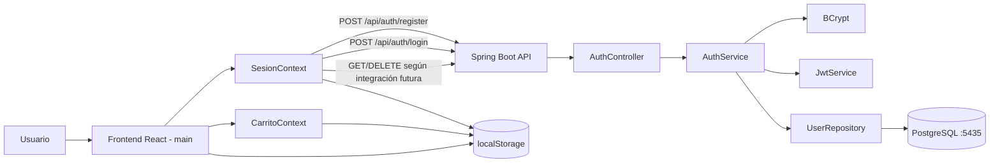
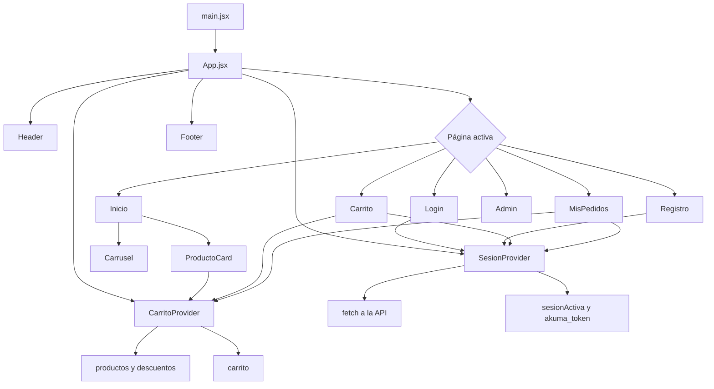
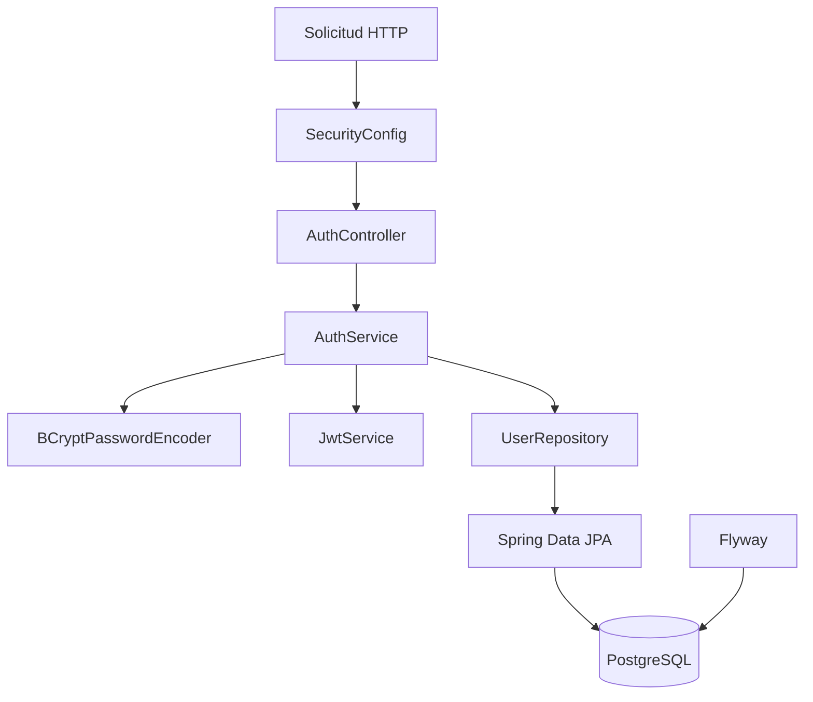
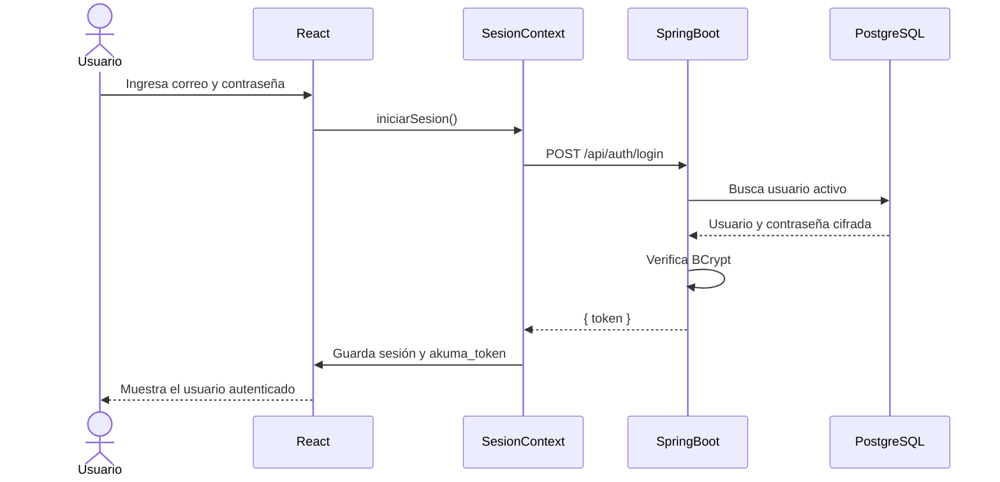
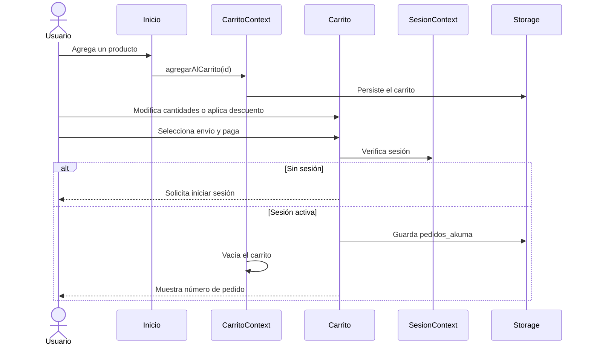

# AkumaTech - Tienda Gamer


AkumaTech es una tienda web gamer desarrollada para el proyecto **Fullstack II - Duoc UC**. El frontend permite consultar el catálogo, administrar el carrito, aplicar descuentos, calcular el envío, iniciar sesión, registrarse, consultar pedidos y acceder al panel de administración.

El proyecto está dividido por ramas:

- [`main`](https://github.com/axbrogi23/AkumaTech_SpringBoot/tree/main): Frontend - aplicación React.
- [`main`](https://github.com/axbrogi23/AkumaTech_Backend): Backend - API de autenticación y productos desarrollada con Spring Boot.

## Tabla de contenidos

- [Funcionalidades](#funcionalidades)
- [Arquitectura general](#arquitectura-general)
- [Arquitectura del frontend](#arquitectura-del-front-end)
- [Arquitectura del backend](#arquitectura-del-backend)
- [Navegación y páginas](#navegación-y-páginas)
- [Flujo de autenticación](#flujo-de-autenticación)
- [Flujo de compra](#flujo-de-compra)
- [Estado y persistencia](#estado-y-persistencia)
- [Tecnologías](#tecnologías)
- [Estructura del frontend](#estructura-del-frontend)
- [Requisitos](#requisitos)
- [Ejecutar el proyecto completo](#ejecutar-el-proyecto-completo)
- [Configuración del frontend](#configuración-del-front-end)
- [API REST](#api-rest)
- [Base de datos](#base-de-datos)
- [Catálogo y promociones](#catálogo-y-promociones)
- [Pruebas](#pruebas)
- [Scripts disponibles](#scripts-disponibles)
- [Documentación adicional](#documentación-adicional)

## Funcionalidades

- Catálogo de 14 productos gamer y componentes de hardware.
- Carrusel de ofertas en la página de inicio.
- Carrito con aumento, disminución y eliminación de productos.
- Códigos de descuento y tres modalidades de envío.
- Registro e inicio de sesión contra una API Spring Boot.
- Token JWT guardado en el navegador.
- Validación de nombre, RUT chileno, correo, contraseña y teléfono.
- Historial de pedidos asociado al usuario.
- Opción para volver a comprar un pedido anterior.
- Panel de administración con estadísticas.
- Gestión local de productos y usuarios.
- Pruebas unitarias, de integración, de usuario y accesibilidad.

## Arquitectura general

El navegador ejecuta React y se comunica con el backend mediante solicitudes HTTP a una API REST. Spring Boot valida los usuarios, cifra contraseñas con BCrypt y genera tokens JWT. Los datos comerciales temporales se mantienen en `localStorage`.



## Arquitectura del front-end

La interfaz utiliza componentes funcionales, hooks de React y contextos globales. `App.jsx` administra la página visible sin React Router y comparte la función `navegar` con las vistas.



### Responsabilidades principales

| Capa | Responsabilidad |
|---|---|
| `main.jsx` | Crea el árbol React y carga los estilos globales. |
| `App.jsx` | Compone la aplicación y controla la navegación por estado. |
| `components/` | Header, Footer, Carrusel y tarjetas reutilizables. |
| `pages/` | Vistas de inicio, autenticación, carrito, pedidos y administración. |
| `context/` | Sesión, autenticación, catálogo y operaciones del carrito. |
| `data/` | Catálogo inicial, descuentos y opciones de envío. |
| `utils/` | Validaciones chilenas y operaciones de `localStorage`. |
| `tests/` | Pruebas unitarias, de integración y accesibilidad. |

## Arquitectura del backend

El backend se encuentra en la rama `backend-axel`. Su arquitectura separa acceso HTTP, lógica de negocio, persistencia y seguridad.



Componentes principales:

- `AuthController`: expone registro, login y eliminación de usuarios.
- `AuthService`: valida usuarios, cifra contraseñas y genera respuestas.
- `JwtService`: crea tokens JWT firmados con duración de 24 horas.
- `UserRepository`: consulta usuarios activos mediante Spring Data JPA.
- `SecurityConfig`: habilita CORS y seguridad HTTP.
- `Flyway`: controla la migración inicial de la tabla `users`.

## Navegación y páginas

La navegación no usa URLs; los destinos se representan con identificadores internos en `App.jsx`.

| Página | Identificador | Función |
|---|---|---|
| Inicio | `inicio` | Carrusel y productos destacados. |
| Login | `login` | Ingreso mediante el backend. |
| Registro | `registro` | Creación de cuenta mediante el backend. |
| Carrito | `carrito` | Cantidades, envío, descuentos y pago. |
| MisPedidos | `mis-pedidos` | Historial y volver a comprar. |
| Admin | `admin` | Estadísticas y acceso administrativo. |
| AdminProductos | `admin-productos` | CRUD local de productos. |
| AdminUsuarios | `admin-usuarios` | CRUD local de usuarios. |

## Flujo de autenticación



El registro envía únicamente `email` y `password`. Los campos adicionales del formulario React se validan en el cliente, pero actualmente el DTO del backend recibe solo correo y contraseña.

## Flujo de compra



## Estado y persistencia

| Clave | Uso |
|---|---|
| `sesionActiva` | Usuario visible en la interfaz. |
| `akuma_token` | JWT recibido al iniciar sesión. |
| `carrito` | Productos y cantidades seleccionados. |
| `productos` | Catálogo administrado localmente. |
| `usuarios` | Usuarios utilizados por la administración local. |
| `pedidos_akuma` | Historial de pedidos creado por el frontend. |

El backend persiste usuarios activos en PostgreSQL. El catálogo, el carrito y los pedidos dependen actualmente de `localStorage`; para producción deberían migrarse también al backend.

## Tecnologías

### Frontend

| Capa | Tecnología |
|---|---|
| UI | React 19 |
| Desarrollo y build | Vite 8 |
| Lenguaje | JavaScript y JSX |
| Estado | React Context |
| Persistencia | `localStorage` |
| Estilos | CSS3 |
| Pruebas | Vitest, Testing Library y jest-axe |

### Backend

| Capa | Tecnología |
|---|---|
| Framework | Spring Boot 4.1.2 |
| Lenguaje | Java |
| Build | Gradle |
| Seguridad | Spring Security y BCrypt |
| Autenticación | JWT con JJWT 0.12.6 |
| Persistencia | Spring Data JPA |
| Migraciones | Flyway |
| Base de datos | PostgreSQL |

## Estructura del frontend

```text
src/
├── assets/              # Imágenes importadas
├── components/          # Header, Footer, Carrusel y ProductoCard
├── context/             # SesionContext y CarritoContext
├── data/                # Catálogo, descuentos y envíos
├── pages/               # Vistas de la aplicación
├── tests/               # Pruebas de componentes y flujos
├── utils/               # Validaciones y almacenamiento
├── App.jsx              # Navegación principal
├── App.css              # Estilos del componente principal
├── index.css            # Estilos globales
├── main.jsx             # Punto de entrada
└── setupTests.js        # Configuración de Vitest
```

## Requisitos

### Frontend

- Node.js 18 o superior.
- npm 9 o superior.

### Backend

- Java 27 según `build.gradle`.
- PostgreSQL disponible en `localhost:5435`.
- Base de datos `authdb`.
- Usuario `authuser` y contraseña `authpass`, o valores configurados de manera local.

## Ejecutar el proyecto completo

### 1. Descargar y ejecutar el frontend

```powershell
git clone https://github.com/axbrogi23/AkumaTech_SpringBoot.git
cd AkumaTech_SpringBoot
git switch main
npm install
npm run dev
```

El frontend estará disponible normalmente en `http://localhost:5173`.

### 2. Descargar el backend en otra carpeta

```powershell
git clone --branch backend-axel --single-branch https://github.com/axbrogi23/AkumaTech_SpringBoot.git AkumaTech_backend
cd AkumaTech_backend
.\gradlew.bat bootRun
```

El backend iniciará en `http://localhost:7778`.

### 3. Configurar PostgreSQL

La configuración predeterminada usa:

```text
Host: localhost
Puerto: 5435
Base de datos: authdb
Usuario: authuser
Contraseña: authpass
```

Es importante tener iniciada la instancia de PostgreSQL antes de ejecutar Spring Boot.

## Configuración del front-end

La URL predeterminada se encuentra en `src/context/SesionContext.jsx`:

```text
http://localhost:7778/api/auth
```

Puede reemplazarse mediante `.env.local`:

```env
VITE_API_URL=http://localhost:7778/api/auth
```

## API REST

| Método | Endpoint | Body | Respuesta |
|---|---|---|---|
| `POST` | `/api/auth/register` | `{ "email": "...", "password": "..." }` | `{ "token": "..." }` |
| `POST` | `/api/auth/login` | `{ "email": "...", "password": "..." }` | `{ "token": "..." }` |
| `DELETE` | `/api/auth/delete/{email}` | Sin body | Sin contenido |

Ejemplo de registro:

```powershell
curl.exe -X POST http://localhost:7778/api/auth/register ^
  -H "Content-Type: application/json" ^
  -d "{\"email\":\"usuario@gmail.com\",\"password\":\"1234\"}"
```

Ejemplo de login:

```powershell
curl.exe -X POST http://localhost:7778/api/auth/login ^
  -H "Content-Type: application/json" ^
  -d "{\"email\":\"usuario@gmail.com\",\"password\":\"1234\"}"
```

## Base de datos

La migración `V1_Create_user_table.sql` crea la tabla `users` con:

- `id`
- `username`
- `email`
- `password`
- `active`
- campos de auditoría gestionados por JPA

Las contraseñas se cifran con BCrypt antes de almacenarse.

## Catálogo y promociones

| Código | Descuento |
|---|---|
| `AKUMA10` | 10% |
| `GAMER30` | 30% |
| `BIENVENIDO15` | 15% |
| `DESCUENTO5` | 5% |
| `CYBERAKUMA40` | 40% |

| Método de envío | Precio |
|---|---|
| Estándar | Gratis |
| Express | $4.990 |
| Same Day | $9.990 |

## Pruebas

```powershell
npm test
npm run test:watch
npm run test:coverage
```

Las pruebas cubren validaciones, `localStorage`, contextos, formularios, navegación, CRUD, renderizado y accesibilidad con `jest-axe`.

El reporte HTML se genera en `coverage/index.html`.

## Scripts disponibles

| Comando | Acción |
|---|---|
| `npm run dev` | Servidor de desarrollo con Vite. |
| `npm run build` | Compilación de producción. |
| `npm run preview` | Vista previa del build. |
| `npm run lint` | Revisión con ESLint. |
| `npm test` | Ejecutar todas las pruebas una vez. |
| `npm run test:watch` | Ejecutar pruebas en modo observación. |
| `npm run test:coverage` | Generar reporte de cobertura. |

## Documentación adicional

- [Diagrama de arquitectura](./diagrama_arquitectura.md)
- [Diagrama de flujo](./diagrama_de_flujo.md)
- [Backend - rama backend-axel](https://github.com/axbrogi23/AkumaTech_SpringBoot/tree/backend-axel)

## Credenciales de prueba

El usuario administrador mostrado por la interfaz no es creado por el backend actual. Se mantiene localmente si no existe un usuario con rol `admin`:

| Rol | Correo | Contraseña |
|---|---|---|
| Administrador local | `admin@gmail.com` | `admin123` |
